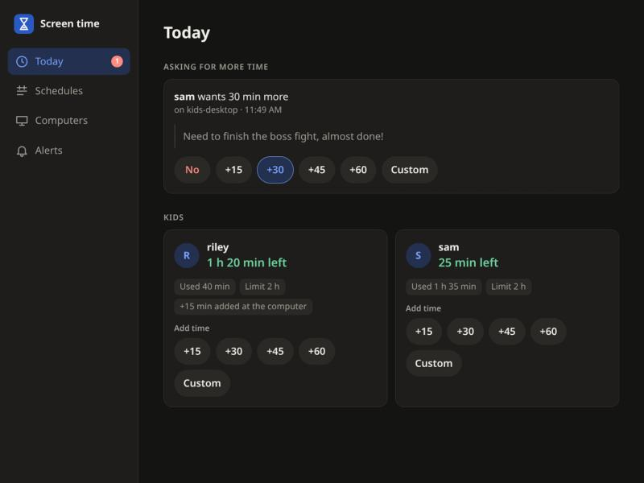

# acceptrequest

Screen time controls for Linux, in the spirit of Windows Family Safety: daily allowances,
downtime schedules, and kids asking for more time with a notification on your phone.



## Pieces

| Crate | What it does |
|---|---|
| `crates/server` | Axum + SQLite policy server over HTTPS, password protected. Hosts the web UI and sends Web Push (or ntfy) notifications with one-tap grant buttons. |
| `crates/web` | Leptos admin UI with desktop and mobile layouts: downtime schedules, allowances, bonus time (+0/15/30/45/60/custom minutes), pending requests. |
| `crates/client` | Root daemon on each machine. Tracks active time through logind, warns at 10/5/1 minutes, locks then terminates sessions, caches policy for offline use. |
| `crates/pam` | `pam_acceptrequest.so`, an account-phase module that blocks login outside allowed time by asking the local daemon. |
| `crates/greeter` | greetd greeter with a "Request more time" button. |
| `crates/common` | Shared types. |

## Building

`cargo build` uses your normal Cargo setup (kache, if `~/.cargo/config.toml` has it). The web UI
is built with `crates/web/build.sh`. `nix build` compiles in a persistent target directory,
`/var/tmp/cargo-nix/acceptrequest` (and `-web`), when the sandbox exposes `/var/tmp/cargo-nix`
(`nix.settings.extra-sandbox-paths = [ "/var/tmp/cargo-nix?" ]`), so a rebuild only recompiles
what changed; otherwise it builds from scratch in the sandbox.

## NixOS

```nix
inputs.acceptrequest.url = "github:benwbooth/acceptrequest";

# on the server
imports = [ acceptrequest.nixosModules.server ];
services.acceptrequest.server.enable = true;

# on each client
imports = [ acceptrequest.nixosModules.client ];
services.acceptrequest.client = {
  enable = true;
  serverUrl = "https://screentime.example:8443";
  managedUsers = [ "kid" ];
  greeter.enable = true;
};
```

## Status

- **Client daemon:** working. Counts unlocked session time through logind, warns at 10/5/1 minutes
  to subscribers on its socket, locks sessions when time runs out and ends them after a grace period,
  caches policy in `/var/lib/acceptrequest/state.json`, syncs with the server, queues time requests.
- **"My parent is here":** working in the daemon and the `acceptrequest` command; a parent's
  admin password adds time on the spot, even during downtime or offline.
- **PAM module:** working. Fails closed for managed users and shows the reason at login.
- **NixOS client module:** working, with assertions against the boot menu editor and managed users in wheel.
- **Server:** working. SQLite storage, per-day allowances shared across machines, downtime,
  bonuses, time requests, per-machine tokens, admin login (argon2, HttpOnly SameSite=Strict cookie,
  throttled), HTTPS via rustls, and a private CA generator for self-signed setups.
- **Notifications:** built-in Web Push (no extra app or service) with one-tap +N buttons, plus a
  page offering 0/15/30/45/60/custom. ntfy is optional.
- **Web UI:** working. Leptos, phone layout (bottom tabs) and desktop layout (sidebar): today's
  status and requests, add time, per-day limits and downtime, computers, notifications.
- **Greeter, warning overlay:** not started.

## Setting up the server

```sh
acceptrequest-server hash-password > admin.hash      # then point adminPasswordHashFile at it
acceptrequest-server gen-cert /var/lib/acceptrequest-tls screentime.lan 192.168.1.10
acceptrequest-server add-client kids-pc              # prints the token for that machine's tokenFile
```

`gen-cert` makes a certificate for the names and addresses you list and prints its fingerprint.
Computers trust the server by that fingerprint, so there is nothing to install on them:

```nix
services.acceptrequest.client.serverFingerprint = "1F:E7:E4:...:3E:6A";
```

The fingerprint changes each time you run `gen-cert`; the server also logs it at startup, and
`acceptrequest-server fingerprint cert.pem` prints it.

**Easiest: a free DuckDNS name.** If you have one, the server can get a real Let's Encrypt
certificate through a DNS challenge, without being reachable from the internet. Phones and
computers then trust it with nothing to install or pin, and built-in notifications work:

```nix
services.acceptrequest.server.duckdns = {
  domain = "yourname.duckdns.org";
  tokenFile = "/run/secrets/duckdns_token";   # just the token
  email = "you@example.com";
};
```

The name must lead to the server from wherever the phone is: a router DNS override (or NAT
loopback) at home and over the VPN, or a port forward.

**Phones are stricter.** Browsers only allow notifications from an HTTPS site they trust, and a
fingerprint can't be given to a phone browser. With a self-signed certificate the web UI works
after tapping through the warning, but notifications won't turn on. For notifications without
installing anything, use a certificate the phone already trusts:

- **Tailscale:** `tailscale cert yourserver.<tailnet>.ts.net`, then point `tls.certFile`/`keyFile` at it.
- **Your own domain:** Let's Encrypt with a DNS challenge through NixOS `security.acme`; the server
  doesn't need to be reachable from the internet.

Or install `ca.pem` from the `gen-cert` directory on the phone once (iPhone: install the profile,
then enable it under Settings > General > About > Certificate Trust Settings; Android: Settings >
Security > Install a certificate > CA certificate).

### Notifications

There are two ways to get time requests on your phone; you can use either or both.

**ntfy (works with a self-signed certificate).** Install the ntfy app, subscribe to a long random
topic such as `https://ntfy.sh/acceptrequest-k3v9q2x7...`, and set
`services.acceptrequest.server.ntfy.url` to it. Requests arrive with up to three +N buttons. A
button posts its answer to `<topic>-answers` on ntfy, which the server follows, so the phone never
connects to the server: the buttons work from anywhere and no certificate has to be trusted.
Each answer carries a single-use secret, so only buttons from a real notification can grant time.
Tapping the notification opens the page with every amount (0/15/30/45/60/custom); that needs the
server reachable, e.g. over your VPN. Keep the topic name secret: anyone who knows it can read the
notifications and use their buttons.

**Built-in Web Push (no app).** Open the web UI on your phone, go to Alerts and tap "Turn on
notifications". This needs a certificate the phone trusts (Let's Encrypt, or `ca.pem` installed
on the phone). On iPhone, first add the page to the Home Screen and open it from there.

```nix
services.acceptrequest.server = {
  enable = true;
  openFirewall = true;
  publicUrl = "https://screentime.example.net:8443";
  tls = { certFile = "/var/lib/acceptrequest-tls/cert.pem"; keyFile = "/var/lib/acceptrequest-tls/key.pem"; };
  adminPasswordHashFile = "/run/secrets/acceptrequest-admin-hash";
};
```

See [docs/DESIGN.md](docs/DESIGN.md) for the anti-bypass and warning design.
